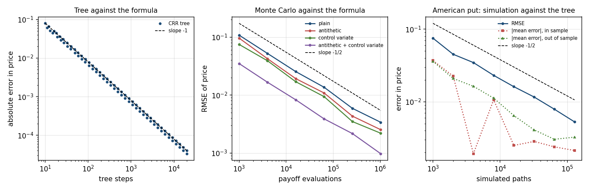

# Triptych

One option priced three ways, by formula, by binomial tree and by simulation, with a measured rate of convergence for each. American puts get a simulated lower and upper bound around a tree value. (A triptych is one picture in three panels.)

## Result

One European put (spot 40, strike 40, rate 6%, volatility 20%, one year):

| Method | Effort | Price | Error against the formula |
| --- | --- | --- | --- |
| Black-Scholes formula | closed form | 2.066401 | |
| Cox-Ross-Rubinstein tree | 16,105 steps | 2.066442 | +0.000041 |
| Smoothed tree with Richardson extrapolation | 184 and 368 steps | 2.066403 | +0.000002 |
| Monte Carlo, antithetic paths and a control variate | 442 million payoffs | 2.066470 ± 0.000050 | +0.000069 |

The plain tree needs 16,105 steps to stay within 0.00005 of the formula. A tree that starts from the Black-Scholes value one step before expiry, extrapolated from 184 and 368 steps, gets there with 368. The simulation was sized for a standard error of 0.00005 and landed 1.4 standard errors high. Plain Monte Carlo would have needed 4.4 billion payoffs for the same standard error; the two variance reductions together cut that tenfold.

For American puts the Longstaff-Schwartz exercise rule was fitted on one set of paths and then valued on 2 million fresh paths, which gives a lower bound. The Andersen-Broadie dual of the same rule gives an upper bound. Six puts from Table 1 of Longstaff and Schwartz (2001), 50 exercise dates a year, one year to expiry:

| Spot | Volatility | Tree | Lower bound | Upper bound |
| --- | --- | --- | --- | --- |
| 36 | 0.2 | 4.4779 | 4.4752 ± 0.0014 | 4.4828 ± 0.0017 |
| 40 | 0.2 | 2.3141 | 2.3109 ± 0.0012 | 2.3167 ± 0.0015 |
| 44 | 0.2 | 1.1099 | 1.1099 ± 0.0012 | 1.1143 ± 0.0014 |
| 36 | 0.4 | 7.1013 | 7.0990 ± 0.0019 | 7.1134 ± 0.0025 |
| 40 | 0.4 | 5.3119 | 5.3088 ± 0.0020 | 5.3189 ± 0.0026 |
| 44 | 0.4 | 3.9477 | 3.9452 ± 0.0024 | 3.9560 ± 0.0029 |

The tree lies inside the bracket in all six cells. The bracket is 0.004 to 0.014 wide. The lower bound sits 0.000 to 0.003 below the tree, and the upper bound 0.003 to 0.012 above it. Least-squares Monte Carlo in the usual form, with the rule fitted and valued on the same paths, also reproduces all 20 values of the paper's Table 1 within three of its reported standard errors.



Left: the plain tree's error falls as one over the number of steps. Middle: every Monte Carlo estimator's error falls as one over the square root of the number of payoffs, and variance reduction moves the line down without changing its slope. Right: least-squares Monte Carlo against the tree. Valued on its own paths it is biased high at small path counts. Valued on fresh paths it is biased low, as a lower bound should be.

The main limit: this is one model, Black-Scholes with constant volatility and rates and no dividends, and the headline is one at-the-money put. The step and path counts above are specific to it.

## The question

A formula, a tree and a simulation should give the same price. How fast does each one get there, and what can a simulation say about the price of an option that can be exercised early?

## Reproduce

```
uv sync
uv run pytest
uv run python scripts/reproduce.py
```

The last command rebuilds every table and figure in `results/`. It took 423 seconds here, most of it in the upper bounds. `--fast` runs small sizes in a few seconds and writes to `results-fast/`, which is not committed; CI uses it.

## What was built

- European options by the Black-Scholes formula, a Cox-Ross-Rubinstein tree, and Monte Carlo
- A smoothed tree and Richardson extrapolation, with the number of steps each needs
- Variance reduction: antithetic paths and a control variate (the discounted stock price), with the factor each one buys
- Greeks three ways: by formula, by finite difference, and by simulation
- American puts by tree, by least-squares Monte Carlo, and by a lower and an upper simulation bound
- A convergence plot for every method, with the expected slope drawn and the fitted slope tabulated with a bootstrap interval

### Bracketing the American put

The exercise rule is the one of Longstaff and Schwartz: at each date, regress the discounted future cash flows of the in-the-money paths on a constant and three Laguerre polynomials of the stock price, and exercise when the exercise value is at least the fitted value of continuing. For the bounds it is fitted on 100,000 paths, half of them antithetic, as in the paper.

The lower bound follows that rule on 2 million fresh paths. No rule does better than the optimal one, so its expected value is at most the true value. The upper bound is the dual of Andersen and Broadie (2004). The value of following the rule defines a martingale, and the expected maximum over exercise dates of the discounted exercise value minus that martingale is at least the option's value. The martingale needs the value of continuing at each in-the-money date, which is estimated by a nested simulation of 4,000 paths. The upper bound uses 400 outer paths.

The nested estimates are noisy, and their noise pushes the upper bound up. With the rule and the 100 outer paths held fixed, the upper bound on the put at spot 36 moves with the number of inner paths like this:

| Inner paths | 500 | 1,000 | 2,000 | 4,000 | 8,000 |
| --- | --- | --- | --- | --- | --- |
| Upper bound minus tree | 0.044 | 0.022 | 0.014 | 0.004 | 0.007 |
| Standard error | 0.011 | 0.007 | 0.005 | 0.004 | 0.003 |

So at 4,000 inner paths part of the gap between the bounds is likely nested noise rather than a poor exercise rule. I did not separate the two.

The usual in-sample estimate is not a bound in either direction. For the put at spot 36 and volatility 0.2 it gave 4.4850 on the fitting paths, above the upper bound of 4.4828 and 0.007 above the tree. Over 20 repeated runs at 1,000 paths the in-sample estimate is on average 0.037 above the tree and the out-of-sample value of the same rule 0.036 below it. At 128,000 paths the two are 0.002 and 0.003 below the tree.

### Fewer tree steps

Steps needed to stay within 0.00005 of the formula, for puts in, at and out of the money. Each count is the smallest from which every larger count, up to the search limit, stays within the tolerance. For the extrapolated methods it is the finer of the two trees, 2n; the tree of n steps is built as well.

| Method | Spot 36 | Spot 40 | Spot 44 |
| --- | --- | --- | --- |
| Plain tree | 18,166 | 16,105 | 12,374 |
| Plain tree, Richardson on even step counts | 9,952 | 68 | 9,544 |
| Smoothed tree | 642 | 3,621 | 3,150 |
| Smoothed tree, Richardson | 252 | 368 | 232 |

The smoothed tree replaces the values one step before expiry with the Black-Scholes value over that last step, which takes the kink of the payoff out of the tree (Broadie and Detemple, 1996). Richardson extrapolation, 2 V(2n) − V(n), then cancels the part of the error that falls as 1/n. On the plain tree it works only at the money. There the strike sits on a node for every even step count and the error is a smooth c/n. Away from the money the error oscillates with where the strike falls between nodes, and extrapolation barely helps (the counts of 9,952 and 9,544 are close to the search limit of 10,000). The smoothed tree removes that oscillation, and extrapolation then needs 44 to 72 times fewer steps than the plain tree.

For the American put at spot 36 the gain is smaller and less regular. Against an extrapolated smoothed tree of 10,000 and 20,000 steps, the smoothed tree stays within 0.00005 from 400 steps on the grid tried (25 to 3,200 steps, doubling), the plain tree only at 3,200, and the extrapolated smoothed tree from 1,600. Early exercise adds error terms that do not fall as 1/n, so extrapolation can make things worse at small step counts. The plain tree of 50,000 steps used as the reference elsewhere differs from this reference by 0.000002 (`results/american_tree_methods.csv`).

### What variance reduction buys

Measured on 10 million payoffs for the European put above. The factor is how many times fewer payoffs the estimator needs than plain Monte Carlo for the same error.

| Estimator | Standard error | Factor | Payoffs for a standard error of 0.00005 |
| --- | --- | --- | --- |
| Plain | 0.001052 | 1.0 | 4.43 billion |
| Antithetic | 0.000824 | 1.6 | 2.72 billion |
| Control variate | 0.000696 | 2.3 | 1.94 billion |
| Both | 0.000332 | 10.0 | 441 million |

The factor depends on moneyness. With spot at 36 the three factors are 3.9, 3.8 and 29. With spot at 44 they are 1.2, 1.6 and 19. Used together the two tricks beat the product of their separate factors in all three cases.

### Greeks three ways

Same put. Finite differences are central differences of the formula with a 0.1% bump. The simulation uses 10 million payoffs.

| Greek | Formula | Finite difference | Simulation | Simulation error, in standard errors |
| --- | --- | --- | --- | --- |
| Delta | -0.344578 | -0.344579 | -0.344673 | -1.4 |
| Gamma | 0.046034 | 0.046034 | 0.046046 | 1.0 |
| Vega | 14.730806 | 14.730805 | 14.734573 | 1.0 |
| Theta | -0.522109 | -0.522109 | -0.522223 | -0.4 |
| Rho | -15.849531 | -15.849531 | -15.853905 | -1.4 |

Finite differences match the formula to at least five significant figures. The simulated greeks are all within 1.5 standard errors. Simulated gamma and vega are the same estimator up to a constant, which is why their errors are equal (see `PAPER.md`).

### Convergence rates

Fitted log-log slopes. The simulated curves plot the root-mean-square error over 100 independent runs per point (20 for least-squares Monte Carlo). Their intervals are 95% bootstrap intervals: resample the runs at each point, recompute the errors, refit, 2,000 times. The tree and finite-difference curves are deterministic and have no interval.

| Curve | Expected slope | Fitted slope | 95% interval |
| --- | --- | --- | --- |
| European tree, error against steps | -1 | -1.000 | |
| Monte Carlo, plain | -0.5 | -0.505 | -0.528 to -0.480 |
| Monte Carlo, antithetic | -0.5 | -0.528 | -0.554 to -0.502 |
| Monte Carlo, control variate | -0.5 | -0.525 | -0.548 to -0.501 |
| Monte Carlo, both | -0.5 | -0.511 | -0.538 to -0.484 |
| Least-squares Monte Carlo, error against paths | -0.5 | -0.531 | -0.608 to -0.456 |
| American tree, error against steps | -1 | -1.016 | |
| Finite-difference delta, error against bump size | 2 | 1.994 | |
| Simulated delta | -0.5 | -0.509 | -0.531 to -0.486 |
| Simulated gamma | -0.5 | -0.520 | -0.542 to -0.499 |
| Simulated vega | -0.5 | -0.520 | -0.541 to -0.498 |
| Simulated theta | -0.5 | -0.517 | -0.538 to -0.496 |
| Simulated rho | -0.5 | -0.514 | -0.536 to -0.489 |

Eight of the ten simulated intervals contain -0.5. The antithetic and control-variate intervals end just short of it, at -0.502 and -0.501. With ten intervals at 95%, about half a miss is expected by chance, so two is somewhat more than that. The intervals are not independent (gamma and vega are the same estimator), and both misses are small. More replications would settle it; I did not run them.

The other figures are `results/american_tree_convergence.png` and `results/greeks_convergence.png`. All tables are in `results/tables.md` and as CSV files beside it.

## Sources

- Black and Scholes, "The Pricing of Options and Corporate Liabilities", Journal of Political Economy 81(3), 1973
- Cox, Ross and Rubinstein, "Option Pricing: A Simplified Approach", Journal of Financial Economics 7(3), 1979
- Longstaff and Schwartz, "Valuing American Options by Simulation: A Simple Least-Squares Approach", Review of Financial Studies 14(1), 2001
- Andersen and Broadie, "Primal-Dual Simulation Algorithm for Pricing Multidimensional American Options", Management Science 50(9), 2004 (method only; not read for this build)
- Broadie and Detemple, "American Option Valuation: New Bounds, Approximations, and a Comparison of Existing Methods", Review of Financial Studies 9(4), 1996 (method only; not read for this build)

`PAPER.md` lists each formula with its equation number and the page it was read from, and says which methods come from secondary knowledge.

## Comparison with the sources

What matches:

- The formula matches all 20 European values in Longstaff and Schwartz's Table 1 to three decimals, and all 27 Black-Scholes values in Cox, Ross and Rubinstein's Table 2 to the cent.
- The tree matches all 54 values for 5 and 20 steps in Cox, Ross and Rubinstein's Table 2 to the cent.
- Least-squares Monte Carlo, set up as in the paper (100,000 paths, half of them antithetic, 50 exercise dates a year, a constant and three Laguerre polynomials), is within three reported standard errors of the paper's value in all 20 cells: 15 within one, 18 within two, the largest gap 2.4.

What does not match:

- The tree, restricted to the paper's 50 exercise dates a year, is within 0.0005 of the paper's finite-difference value in 15 of 20 cells and within 0.004 in 19. In the last cell (spot 44, volatility 40%, two years) the tree gives 5.6412 and the paper 5.647. The tree is converged there: 50, 100 and 200 steps per exercise date give 5.6412, 5.6414 and 5.6412. The paper says its two finite-difference schemes agreed "generally within one cent", so the gap is inside the paper's own tolerance. All five cells with volatility 40% and two years sit 0.001 to 0.006 below the paper.
- The paper's standard errors are larger than the sampling error. They are reproduced, to within 11%, by treating all 100,000 paths as independent. Half the paths mirror the other half, and the standard error computed from the mirrored pairs is 43% to 84% of that figure. Twenty repeated runs at 128,000 paths gave a spread of 0.0050 where the pair-based figure predicts 0.0053 and the all-independent figure 0.0082.

Full detail is in `PAPER.md`.

## Data

None. Every number comes from a formula or a seeded simulation.

## How it is tested

`uv run pytest` runs 1,342 tests in about 25 seconds.

- Put-call parity to within four units of machine precision, over 480 parameter sets
- The Black-Scholes differential equation holds for the analytic greeks
- The tree matches the published Table 2 of Cox, Ross and Rubinstein, equals their n-period sum, and halves its error when the steps double
- The smoothed tree equals its own n-period sum, and Richardson extrapolation of it is within 0.00005 of the formula at 400 and 800 steps for three spots
- Monte Carlo is within three standard errors of the formula for every estimator
- The variance-reduction estimators are unbiased over 2,000 repeated runs, and the reported standard errors match the spread of those runs
- An American put is never worth less than the European put or its exercise value
- Greeks agree three ways
- Least-squares Monte Carlo reproduces Table 1 of Longstaff and Schwartz
- Following a fitted rule on its own paths gives back the in-sample cash flows; with one exercise date both bounds equal the European price
- The lower bound minus three standard errors is below the tree, and the tree is below the upper bound plus three standard errors
- The bootstrap slope interval covers the true slope of a synthetic curve
- Two runs of the reproduce pipeline write identical files

## Layout

```
src/triptych/          the code
tests/                 maths tests
scripts/reproduce.py   one command rebuilds every figure and table
results/               committed figures and tables
PAPER.md               citations, formulas, comparison with the sources
```

## Limits

- Constant volatility and constant rates throughout, and no dividends.
- The headline is one at-the-money put. The step and path counts are specific to it. The variance-reduction factors alone range from 10 to 29 across the three spots tried.
- The bounds cover six one-year puts, not all 20 cells of Table 1. The two-year cells have twice the exercise dates, and the upper bound's cost grows with the square of that number.
- The width of the bracket mixes two things: how far the fitted rule is from the best one, and the noise of the nested simulations. They were not separated.
- The upper bound uses a single nested-simulation size per cell. Its standard error does not include the bias from that nesting, which is upward only.
- Richardson extrapolation of the American tree is irregular. The smoothed tree alone did better on the grid tried.
- The control variate is the stock price alone. A better control would cut the 442 million payoffs further; none was tried.
- Gamma by simulation is a likelihood-ratio estimator applied to the pathwise delta. A purely pathwise gamma does not exist for a payoff with a kink.
- The paper's random numbers are unknown, so its Table 1 can be matched only up to sampling error.
- This is textbook material. What it offers is that it is checked against the sources, tested, and that every number can be reproduced.
- This is research code. It is not investment advice and it does not trade.

## Licence

MIT. See `LICENSE`.
